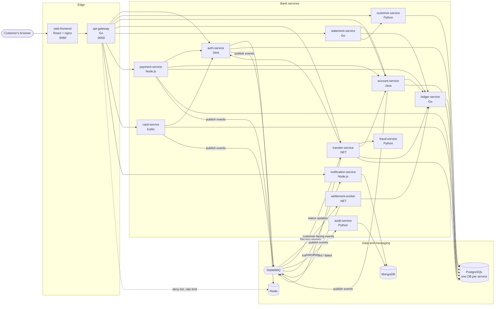
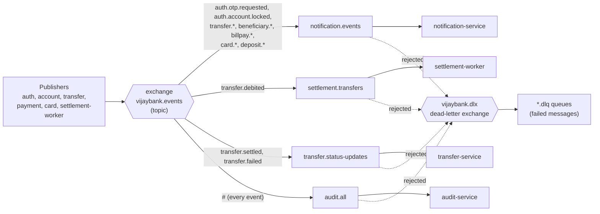
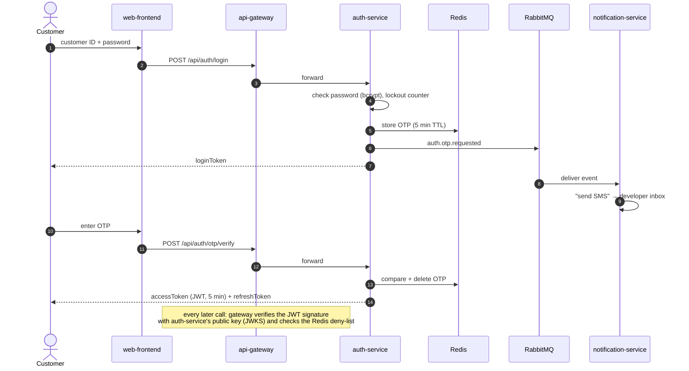
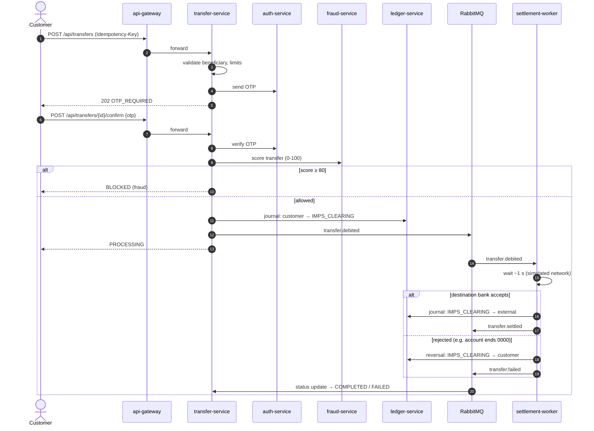
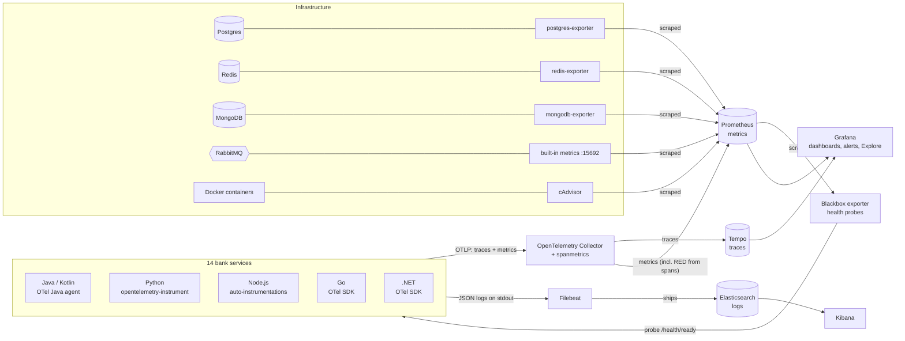
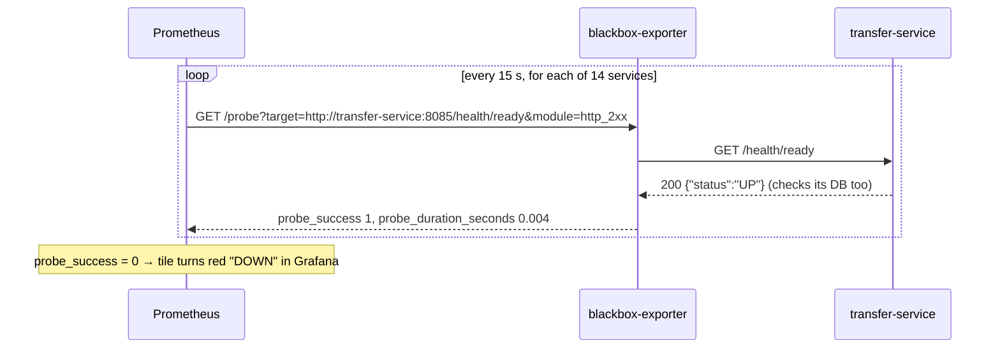
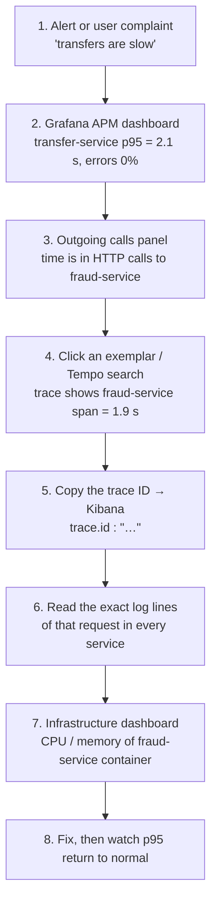

# VijayBank — Net Banking Platform (learning project)

VijayBank is a **fictional retail bank** built as a set of microservices in six
languages, run on one laptop with Docker Compose. It exists to practise two
things on something that looks and behaves like a real system:

1. **Building distributed systems**: microservices, an API gateway, events over a
   message broker, money handled correctly (double-entry ledger, idempotency).
2. **SRE and observability**: traces, metrics, logs, dashboards, health checks
   and alerts, with **OpenTelemetry**, **Prometheus**, **Grafana**, **Tempo** and
   **Filebeat → Elasticsearch → Kibana**.

> All names, customers and money are fake. "VijayBank" is not a real bank and the
> UI deliberately does not copy any real bank's branding.

---

## Contents

1. [Quick start](#1-quick-start)
2. [The big picture](#2-the-big-picture)
3. [The bank services](#3-the-bank-services)
4. [Infrastructure tools (databases, cache, broker)](#4-infrastructure-tools)
5. [How the main flows work](#5-how-the-main-flows-work)
6. [Observability: the big picture](#6-observability-the-big-picture)
7. [Observability tools, one by one](#7-observability-tools-one-by-one)
8. [Grafana dashboards and alerts](#8-grafana-dashboards-and-alerts)
9. [Investigating a problem end to end](#9-investigating-a-problem-end-to-end)
10. [Test data and API examples](#10-test-data-and-api-examples)
11. [Everyday commands and troubleshooting](#11-everyday-commands-and-troubleshooting)
12. [Repository layout](#12-repository-layout)
13. [Glossary](#13-glossary)
14. [Project status and roadmap](#14-project-status-and-roadmap)

---

## 1. Quick start

**You need:** Docker Desktop with at least 8 GB of memory assigned to it
(Settings → Resources). Nothing else is needed: every language toolchain runs inside Docker.

There are two Compose files:

| File | What it starts |
|---|---|
| `docker-compose.yml` | The bank only: 14 services, PostgreSQL, Redis, RabbitMQ, MongoDB, seed job |
| `docker-compose.observability.yml` | Adds monitoring: OpenTelemetry, Prometheus, Grafana, Tempo, Elasticsearch, Kibana, Filebeat, exporters |

```bash
cd ~/Projects/vijaybank

# Bank + full observability stack (recommended)
docker compose -f docker-compose.yml -f docker-compose.observability.yml up -d --build

# ...or the bank alone
docker compose up -d --build
```

The first build takes several minutes because every service is compiled. Then:

```bash
docker compose ps            # wait until the services show "healthy"
docker compose logs seed     # "seed complete" = demo customers are ready
```

> **Tip:** `alias vb='docker compose -f docker-compose.yml -f docker-compose.observability.yml'`
> lets you type `vb ps`, `vb logs -f transfer-service`, `vb down`.

### Where to click

| What | URL | Login |
|---|---|---|
| **Net banking UI** | http://localhost:8080 | Customer `VB100001` … `VB100020`, password `Welcome@123` |
| API gateway | http://localhost:8000 | Bearer token (see [API examples](#10-test-data-and-api-examples)) |
| RabbitMQ management | http://localhost:15672 | `vijaybank` / `vijaybank_pw` |
| **Grafana** (dashboards, traces, alerts) | http://localhost:3000 | None (anonymous admin, lab only) |
| **Kibana** (logs) | http://localhost:5601 | None (security disabled, lab only) |
| Prometheus | http://localhost:9090 | None |
| Elasticsearch API | http://localhost:9200 | None |

**The OTP** for login, transfers and bill payments is "sent by SMS". There is no
real SMS: it shows up in the **Developer inbox** panel on the OTP screen.

---

## 2. The big picture



**How to read it:**

- The **browser only talks to `web-frontend`**. nginx serves the React app and
  forwards every `/api/...` call to **api-gateway**.
- **api-gateway is the only door into the bank.** It checks the login token,
  rate-limits, adds a request ID and forwards the call to the right service.
  Internal services are not reachable from outside Docker.
- Services call each other over **HTTP** when they need an answer right now
  ("is this OTP correct?", "post this journal").
- They publish **events to RabbitMQ** for things that can happen later
  ("a transfer was debited, settle it", "send an SMS", "write the audit trail").
- **ledger-service is the single source of truth for money.** Nobody else
  stores balances.

---

## 3. The bank services

| Service | Language / framework | Port | Data | What it does |
|---|---|---|---|---|
| **web-frontend** | React 18 + TypeScript + Vite, served by nginx | 8080 (published) | — | The net banking UI. Proxies `/api` to the gateway. |
| **api-gateway** | Go 1.23 (chi) | 8000 (published) | Redis | Routing, JWT validation (RS256 keys from auth-service), logout deny-list, per-IP rate limiting (20 req/s, burst 40), `X-Request-Id`. |
| **auth-service** | Java 21 / Spring Boot 3 | 8081 | Postgres `auth`, Redis | Password + OTP login, lockout after 5 wrong passwords, JWT access (5 min) and refresh tokens, OTP send/verify for other services. |
| **customer-service** | Python / FastAPI | 8082 | Postgres `customer` | Customer profile and KYC status. |
| **account-service** | Java 21 / Spring Boot 3 | 8083 | Postgres `account` | Savings and current accounts, **fixed deposits** (quarterly compounding, premature close penalty). Reads balances from the ledger. |
| **ledger-service** | Go 1.23 (pgx) | 8084 | Postgres `ledger` | **Double-entry ledger.** Atomic, idempotent journal postings; balances; account entries. Internal only. |
| **transfer-service** | .NET 8 / ASP.NET Core | 8085 | Postgres `transfer` | Beneficiaries (with OTP and 24 h cooling limit), transfer limits, the transfer workflow: OTP → fraud check → ledger debit → event. |
| **fraud-service** | Python / FastAPI | 8086 | — (stateless) | Rule-based risk score 0–100 for each transfer: allow, flag (≥ 50) or block (≥ 80). |
| **notification-service** | Node.js / Express | 8087 | MongoDB | Consumes events and "sends" SMS. Stores notification history and serves the developer inbox. |
| **audit-service** | Python / FastAPI | 8088 | MongoDB | Writes **every** event to an append-only audit trail, with secrets redacted. |
| **statement-service** | Go 1.23 | 8089 | — | Transaction history with filters and paging; **PDF and CSV statements**. |
| **payment-service** | Node.js / Express | 8090 | Postgres `payment` | Bill payments to simulated billers (electricity, mobile, DTH…) with OTP. |
| **card-service** | Kotlin / Ktor | 8091 | Postgres `card` | Debit and credit cards: instant block, OTP to unblock or raise limits, international/contactless switches. |
| **settlement-worker** | .NET 8 | 8092 | — | Simulates the interbank networks. IMPS ≈ 1 s, RTGS ≈ 2 s, NEFT in 30-second batches. Settles or **reverses** each transfer. |
| **seed** | Python | — | — | One-shot job: creates 20 demo customers with accounts, cards, FDs and beneficiaries through internal APIs. Safe to re-run. |

**Why so many languages?** On purpose. Real companies are polyglot, and each
language is instrumented differently for observability: Java agent, Python
launcher, Node `--require` hook, Go SDK, .NET SDK. VijayBank covers all of them.

### Money rules (the most important design decision)

1. **Amounts are integers in paise** (₹1 = 100 paise). Never floating point.
2. **Double-entry:** every money movement is a *journal* whose debit and credit
   entries add up to zero. Balances are never edited directly.
3. **Atomic:** a journal, its entries and the balance updates are written in **one
   database transaction**, with the balance rows locked in a fixed order (no deadlocks).
4. **Idempotent:** every money-moving request carries an `Idempotency-Key`.
   A retry returns the first result instead of moving money twice.
5. **Reversals, never deletes:** a failed transfer is undone with a new reversing journal.
6. **Fail closed:** if fraud-service can't be reached, the transfer is refused
   (`503 FRAUD_CHECK_UNAVAILABLE`). No money leaves without a fraud decision.

| Transfer mode | Limit | Speed |
|---|---|---|
| Own account / within VijayBank | up to ₹10,00,000 | Instant |
| IMPS | up to ₹5,00,000 | ≈ 1 second |
| NEFT | up to ₹10,00,000 | Next 30-second batch |
| RTGS | minimum ₹2,00,000 | ≈ 2 seconds |

Daily limit: ₹10,00,000 per customer across all modes. A new beneficiary is limited
to ₹50,000 in the first 24 hours.

| Fraud rule | Points |
|---|---|
| Amount > ₹2,00,000 | 30 |
| Beneficiary added < 24 h ago | 25 |
| More than 5 transfers in 10 minutes | 30 |
| First transfer to this bank | 10 |
| Odd hours (00:00–05:00 IST) | 10 |

Score ≥ 80 → **block**; 50–79 → allow and **flag** (`fraud.flagged` event).
Full design: [docs/DESIGN.md](docs/DESIGN.md).

---

## 4. Infrastructure tools

### PostgreSQL 16: the main database

| | |
|---|---|
| **What it is** | A relational (SQL) database with strong transactions. |
| **Why VijayBank uses it** | Money needs ACID transactions and row locks. Each service gets **its own database** and user (`auth`, `customer`, `account`, `ledger`, `transfer`, `payment`, `card`), so no service can read another's tables. This is the "database per service" microservice pattern. |
| **Where** | Container `postgres`, created by `infra/postgres/init/01-databases.sql`. A read-only `grafana_ro` user lets Grafana show business numbers. |
| **Look inside** | `docker compose exec postgres psql -U postgres -d ledger -c 'select * from ledger_accounts limit 5;'` |

### Redis 7: fast temporary data

| | |
|---|---|
| **What it is** | An in-memory key-value store. Very fast; entries can expire automatically. |
| **Why VijayBank uses it** | **OTPs** (expire after 5 minutes), **failed-login counters** (for lockout), the **logout deny-list** (a logged-out token is rejected until it would have expired anyway) and rate-limit state. Data that is short-lived and read on every request. |
| **Look inside** | `docker compose exec redis redis-cli keys '*'` |

### RabbitMQ 3.13: the message broker

| | |
|---|---|
| **What it is** | A message broker. Services publish messages to an *exchange*; RabbitMQ routes copies into *queues*; consumers read from the queues. |
| **Why VijayBank uses it** | **Decoupling and reliability.** transfer-service doesn't wait for interbank settlement or SMS sending. It publishes `transfer.debited` and returns. If a consumer is down, messages wait in its queue. Failed messages go to a **dead-letter queue (DLQ)** instead of being lost. |
| **UI** | http://localhost:15672 (`vijaybank` / `vijaybank_pw`): queues, message rates, DLQ contents. |
| **Config** | `infra/rabbitmq/definitions.json`: exchanges, queues and bindings are created at start-up. |



### MongoDB 7: document store

| | |
|---|---|
| **What it is** | A document database that stores JSON-like records with no fixed schema. |
| **Why VijayBank uses it** | **Notification history** and the **audit trail**: append-only records whose shape differs per event type. |
| **Look inside** | `docker compose exec mongodb mongosh notifications --eval 'db.notifications.find().sort({_id:-1}).limit(3)'` |

### nginx: web server and reverse proxy

nginx serves the compiled React files and proxies `/api/*` to api-gateway, so
the browser sees a single origin (no CORS problems).

---

## 5. How the main flows work

### 5.1 Login with OTP (two-step)



### 5.2 Fund transfer to another bank (IMPS)



The audit and notification services also receive every one of these events
(not drawn, to keep the diagram readable).

---

## 6. Observability: the big picture

**Observability** means being able to answer *"what is happening inside the
system, and why?"* from the outside, without adding new code each time. It is
built on three kinds of data, often called the **three pillars**:

| Pillar | Question it answers | Example in VijayBank | Stored in | Viewed in |
|---|---|---|---|---|
| **Metrics** (numbers over time) | *Is something wrong? How much? Since when?* | "transfer-service p95 latency jumped from 120 ms to 2 s at 14:05" | Prometheus | Grafana |
| **Traces** (the path of one request) | *Where is the time going? Which service failed?* | "This transfer spent 1.8 s waiting for fraud-service" | Tempo | Grafana |
| **Logs** (text events) | *What exactly happened, with what values?* | "fraud-service: score=85 rules=[AMOUNT, NEW_BENEFICIARY]" | Elasticsearch | Kibana |

The three are **linked by the trace ID**: every log line carries the `trace.id` of
the request that produced it, and metric data points carry example trace IDs
(*exemplars*). You can jump from a spike on a chart, to a slow trace, to that
request's exact log lines.



**Two delivery styles, both used here:**

- **Push:** the apps *send* traces and metrics to the OpenTelemetry Collector (OTLP protocol).
- **Pull (scrape):** Prometheus *fetches* `/metrics` pages from exporters every
  15 seconds.

---

## 7. Observability tools, one by one

Every tool below follows the same pattern: **what it is → why VijayBank needs
it → where it is configured → how to use it.**

### 7.1 OpenTelemetry (OTel): instrumentation standard

| | |
|---|---|
| **What it is** | A vendor-neutral, open standard (CNCF) plus libraries for producing traces, metrics and logs. Instrument once, send anywhere: Tempo, Jaeger, New Relic, Datadog, Elastic… |
| **Why VijayBank needs it** | Without it, services are black boxes. With it, every HTTP request, SQL query, Redis command and RabbitMQ message becomes a **span** automatically, and the trace ID travels between services in the W3C `traceparent` header. That is how one transfer shows up as **one trace across 8 services**. |
| **Where** | `docker-compose.observability.yml` sets the shared `OTEL_*` environment variables (anchor `x-otel`). Without that file, the services run with telemetry off. |

**How each language is instrumented:**

| Language | Services | Method | Code changes? |
|---|---|---|---|
| Java / Kotlin | auth, account, card | **OTel Java agent** (`-javaagent:` via `JAVA_TOOL_OPTIONS`), jar baked into the image | None (auth-service adds 2 custom OTP counters) |
| Python | customer, fraud, audit | **`opentelemetry-instrument`** launcher wrapping uvicorn | Minimal (FastAPI instrumented in `main.py` so access logs get trace IDs) |
| Node.js | payment, notification | **auto-instrumentations-node** loaded through `NODE_OPTIONS=--require …` | Logger adds `trace_id` |
| Go | api-gateway, ledger, statement | **OTel Go SDK** in `otel.go` (otelhttp, otelpgx, redisotel) | Yes: Go has no agent |
| .NET | transfer, settlement-worker | **OTel .NET SDK** in `Telemetry.cs` (ASP.NET Core, HttpClient, Npgsql) + manual RabbitMQ header propagation | Yes |

**Custom business metrics.** auth-service records `vijaybank_otp_sent_total` and
`vijaybank_otp_verifications_total{purpose,result}`, which drive the OTP panels and the OTP alert.

### 7.2 OpenTelemetry Collector: the telemetry router

| | |
|---|---|
| **What it is** | A standalone process that receives telemetry, processes it, and exports it to one or more back ends. |
| **Why VijayBank needs it** | Apps only need to know **one address** (`otel-collector:4318`). Back ends can be swapped or added (e.g. New Relic) by editing one file, without touching 14 services. It also batches data, limits memory, and runs the **spanmetrics connector**, which turns every span into request-count and latency metrics. That is where the APM dashboard's rpm, latency and error % come from. |
| **Config** | `observability/otel-collector.yaml`: receivers `otlp` → processors `memory_limiter, batch` → exporters `otlp/tempo` (traces) and `prometheus` (metrics on `:8889`). |

### 7.3 Tempo: trace storage

| | |
|---|---|
| **What it is** | Grafana's distributed-tracing back end. It stores traces cheaply and finds them by trace ID or with **TraceQL** queries. |
| **Why VijayBank needs it** | To answer *"why was **this** request slow / failed?"* Metrics tell you *that* p95 is high; a trace shows *which hop* took the time. |
| **Use it** | Grafana → **Explore** → data source **Tempo**. Examples: |

```text
{ resource.service.name = "transfer-service" && duration > 500ms }
{ resource.service.name = "settlement-worker" && name = "settlement.transfers process" }
{ status = error }
```

> Tempo has no volume in this lab: traces are lost when the container is recreated.

### 7.4 Prometheus: metrics database

| | |
|---|---|
| **What it is** | A time-series database that **scrapes** (pulls) metrics from HTTP endpoints at a fixed interval and is queried with **PromQL**. The de-facto standard for metrics in cloud-native systems. |
| **Why VijayBank needs it** | Dashboards and alerts are built on metrics: they are cheap to keep, fast to query, and ideal for "is it healthy right now?" and trends. |
| **Config** | `observability/prometheus.yml` |
| **UI** | http://localhost:9090 → *Status → Targets* shows whether every scrape is UP. |

**What Prometheus scrapes:**

| Job | Target | What you get |
|---|---|---|
| `otel-collector` | collector `:8889` | App metrics: spanmetrics (RED per service/endpoint), JVM, Go, .NET runtime, OTP counters |
| `postgres` | postgres-exporter | Connections, transactions/s, cache hit ratio, DB sizes, locks |
| `redis` | redis-exporter | Memory, connected clients, commands/s, keys, hit ratio |
| `mongodb` | mongodb-exporter | Operations/s, connections, document counts |
| `rabbitmq`, `rabbitmq-queues` | RabbitMQ built-in `:15692` | Queue depth, publish/deliver rates, unacked messages, DLQ size |
| `cadvisor` | cAdvisor | CPU, memory, network **per container** |
| `bank-services` | blackbox-exporter | **UP/DOWN** of each service's `/health/ready` |
| `prometheus` | itself | Prometheus's own health |

Example PromQL queries:

```promql
# Requests per minute by service (from spanmetrics)
sum by (service_name) (rate(traces_span_metrics_calls_total{span_kind="SPAN_KIND_SERVER"}[5m])) * 60

# Which services are down right now?
probe_success{job="bank-services"} == 0

# Messages waiting in RabbitMQ dead-letter queues
sum by (queue) (rabbitmq_detailed_queue_messages{queue=~".*dlq"})
```

### 7.5 Exporters: translators for things that don't speak Prometheus

An **exporter** is a small sidecar that reads a system's internal statistics and
publishes them as a Prometheus `/metrics` page.

| Exporter | Watches | Why it matters in a bank |
|---|---|---|
| **postgres-exporter** | PostgreSQL | Connection exhaustion or lock waits slow every money movement. |
| **redis-exporter** | Redis | If Redis is down, nobody can log in (OTPs, deny-list). |
| **mongodb-exporter** | MongoDB | Audit trail must keep up; regulators expect a complete log. |
| **cAdvisor** | Every Docker container | Finds the container eating CPU or memory, or being OOM-killed. |
| **RabbitMQ (built-in plugin)** | Queues | A growing queue means a consumer is down or too slow (e.g. settlements piling up). |
| **blackbox-exporter** | Each service's `/health/ready` from the outside | The simplest possible question: *does it answer?* Equivalent to a synthetic "ping" monitor. |

**How a blackbox health probe works:**



### 7.6 Grafana: the single pane of glass

| | |
|---|---|
| **What it is** | A visualisation and alerting tool. It doesn't store data; it queries data sources (Prometheus, Tempo, PostgreSQL…) and draws dashboards. |
| **Why VijayBank needs it** | One place to see business KPIs, service health, infrastructure and traces side by side, and to raise alerts. |
| **Config as code** | Everything is provisioned from files at start-up. Nothing is clicked together by hand: |

| Path | Contents |
|---|---|
| `observability/grafana/provisioning/datasources/` | Prometheus, Tempo (with trace ↔ metrics links), PostgreSQL (read-only) |
| `observability/grafana/provisioning/dashboards/` + `observability/grafana/dashboards/*.json` | The 3 dashboards |
| `observability/grafana/build_dashboards.py` | **Generates** the dashboard JSON. Edit this, run it, restart Grafana. |
| `observability/grafana/provisioning/alerting/` | Alert rules |

### 7.7 Filebeat: log shipper

| | |
|---|---|
| **What it is** | A lightweight agent from Elastic that tails log files and ships them to Elasticsearch. |
| **Why VijayBank needs it** | Each service writes **JSON logs to stdout**, and Docker saves them as files. Filebeat discovers every `vijaybank-*` container automatically, reads its log file, parses the JSON, and adds `service.name`, `log.level`, `message` and **`trace.id`**. The services don't need to know about Elasticsearch at all. |
| **Config** | `observability/filebeat.yml`. Five log formats (Java, Python, Node, Go, .NET) are normalised to the same field names by a small script processor. Health-check lines are dropped. |

> Docker Desktop's default log driver (`local`) is binary. The app services use
> `json-file` logging (anchor `x-json-logs`) so Filebeat can read them.

### 7.8 Elasticsearch: log storage and search

| | |
|---|---|
| **What it is** | A search engine and document store, very good at full-text search and aggregations over large volumes of logs. |
| **Why VijayBank needs it** | To search all services' logs at once: by customer, request ID, trace ID, error text or time range. |
| **Where** | Index `vijaybank-logs`. Single node, security disabled, **no volume** (lab only: logs are lost when the container is recreated). |

### 7.9 Kibana: log UI

| | |
|---|---|
| **What it is** | Elastic's web UI for Elasticsearch: search (Discover), dashboards, visualisations. |
| **Use it** | http://localhost:5601 → **Discover** → data view `vijaybank-logs*`. |

Useful Kibana searches (KQL):

```text
service.name : "transfer-service" and log.level : "ERROR"
trace.id : "c81bb7c876e5527c75c43e684535dc42"        ← every line of one request, all services
message : "reversed*"                                   ← settlement reversals
app.requestId : "36054da7d7a750a11fa4a4ba075a3b7d"     ← the requestId shown in an API error
```

> If Elasticsearch was recreated, create the data view again: *Stack Management →
> Data Views → Create*, pattern `vijaybank-logs*`, timestamp `@timestamp`.

### Tool summary: who does what

| Tool | Category | Pull or push | Port | One-line use case |
|---|---|---|---|---|
| OpenTelemetry SDK / agents | Instrumentation | push | — | Turn every request, query and message into spans and metrics |
| OTel Collector | Pipeline | receives push | 4317/4318 | Single entry point; routes traces to Tempo and metrics to Prometheus; builds RED metrics |
| Tempo | Trace store | — | 3200 (internal) | "Why was this request slow?" |
| Prometheus | Metric store | pull | 9090 | "Is it healthy? Since when?"; source for dashboards and alerts |
| Exporters + cAdvisor | Metric sources | scraped | various | Make Postgres, Redis, Mongo, RabbitMQ and containers visible |
| Blackbox exporter | Synthetic checks | scraped | 9115 (internal) | UP/DOWN of every service |
| Grafana | Visualisation and alerting | queries | 3000 | Dashboards, Explore, alerts |
| Filebeat | Log shipper | push | — | Collect container logs, add trace IDs |
| Elasticsearch | Log store | — | 9200 | Search all logs |
| Kibana | Log UI | queries | 5601 | Discover and filter logs |

### Comparison with commercial tools (e.g. New Relic)

| New Relic part | Open-source equivalent here |
|---|---|
| APM language agents | OpenTelemetry agents / SDKs → Collector → Tempo + Prometheus |
| Infrastructure agent | cAdvisor (containers), node exporter (hosts, not used here) |
| On-host integrations (Postgres, Redis…) | postgres / redis / mongodb exporters |
| Logs in context | Filebeat → Elasticsearch → Kibana, linked by `trace.id` |
| Synthetics ping monitor | Blackbox exporter |
| Dashboards and alerts | Grafana |

Because the apps emit **standard OTLP**, switching to a vendor is a Collector
config change: add an exporter. No application code changes.

---

## 8. Grafana dashboards and alerts

Open http://localhost:3000 → **Dashboards → VijayBank**.

### VijayBank — APM (`vb-apm`): "are the services healthy?"

| Row | Shows | Use it to… |
|---|---|---|
| Service health | Green **UP** / red **DOWN** tile per service (blackbox) | Spot an outage at a glance |
| Services overview | Table per service: health, **rpm**, avg and **p95 response time**, **error %**, transactions, errors, **Apdex** | Find the worst service |
| Golden signals | Throughput, latency, errors per service over time (with exemplar dots → click for a trace) | See when it started |
| Outgoing calls | Time spent in databases, HTTP calls and messaging, per service | Is it my code or my dependency? |
| JVM runtime | Heap, GC, threads (Java and Kotlin services) | Memory leaks, GC pauses |
| Traces | Recent traces from Tempo | Jump into a request |

### VijayBank — Business (`vb-business`): "is the bank working for customers?"

Money movement (transfers by mode and status, settlement failures and reversals),
bill payments, deposits and cards, customers and security (logins, lockouts),
and **OTP sent / verified / failed**.

### VijayBank — Infrastructure (`vb-infra`): "is the platform OK?"

Scrape health, containers (CPU and memory from cAdvisor), PostgreSQL, RabbitMQ
(queue depth, DLQs), Redis and MongoDB.

### Alerts

| Alert | Condition | File |
|---|---|---|
| **OTP failures** | Any failed OTP verification in the last 5 minutes, per purpose (login, transfer, bill pay…) | `observability/grafana/provisioning/alerting/otp-alerts.yaml` |

View them under Grafana → **Alerting → Alert rules**. No contact point (email,
Slack, Teams) is configured yet, so alerts show in Grafana only.

---

## 9. Investigating a problem end to end

A typical on-call path, using all the tools together:



**Try it yourself:**

1. Make a transfer in the UI (http://localhost:8080).
2. Grafana → Explore → Tempo → query
   `{ resource.service.name = "settlement-worker" }`. Open the newest trace.
   You'll see gateway → transfer → auth → fraud → ledger → RabbitMQ →
   settlement-worker → ledger → audit and notification, in one picture.
3. Copy the trace ID, open Kibana Discover, search `trace.id : "<id>"`.
   Every log line from every service for that one transfer appears.
4. Stop a service: `docker compose stop fraud-service`. Within ~15 s its tile on
   the APM dashboard turns **DOWN**, and transfers to other banks are refused with
   `FRAUD_CHECK_UNAVAILABLE` (fail closed). Watch the error % rise on
   transfer-service, then find the failing requests in Tempo (`{ status = error }`)
   and Kibana. Start it again with `docker compose start fraud-service`.

---

## 10. Test data and API examples

**Customers:** `VB100001` … `VB100020`, password `Welcome@123`.

| What | How |
|---|---|
| Two accounts (own transfers) | VB100003, VB100006, VB100009 … (every 3rd customer) |
| Credit card | VB100001, VB100003, VB100005 … (odd customers) |
| Existing fixed deposit | VB100001, VB100004, VB100007 … |
| See a transfer reversed | Send IMPS/NEFT to the beneficiary "Rejected Payee (test)" (account ends in 0000) |
| Bill with nothing due | Any consumer number ending in 0 |
| Trigger the lockout | 5 wrong passwords |
| Trigger the OTP alert | Enter a wrong OTP on any OTP screen |

### Try the API with curl

```bash
# 1. password step -> loginToken
curl -s localhost:8000/api/auth/login -H 'Content-Type: application/json' \
  -d '{"customerId":"VB100001","password":"Welcome@123"}'

# 2. read the OTP from the simulated SMS inbox
curl -s 'localhost:8000/api/notifications/dev-inbox?customerId=VB100001'

# 3. OTP step -> accessToken
curl -s localhost:8000/api/auth/otp/verify -H 'Content-Type: application/json' \
  -d '{"loginToken":"<loginToken>","otp":"<otp>"}'

# 4. call an authenticated endpoint
curl -s localhost:8000/api/accounts -H 'Authorization: Bearer <accessToken>'
```

Every response carries an `X-Request-Id` header. Search it in Kibana (`app.requestId`)
to see that request's logs.

---

## 11. Everyday commands and troubleshooting

```bash
VB="docker compose -f docker-compose.yml -f docker-compose.observability.yml"

$VB ps                                       # status of everything
$VB logs -f transfer-service                 # follow one service's logs
$VB up -d --build --no-deps ledger-service   # rebuild + restart one service after a code change
$VB restart grafana                          # reload dashboards after build_dashboards.py
$VB down                                     # stop and remove containers, KEEP data
$VB down -v                                  # stop and DELETE all data (re-seeds on next up)
```

| Symptom | Cause | Fix |
|---|---|---|
| UI shows errors / 502 after rebuilding api-gateway | nginx in web-frontend still uses the gateway's old IP | `$VB restart web-frontend` |
| A Java service stops sending traces after the Collector restarted | The Collector got a new IP; the Java agent keeps the old one | Restart that service |
| A change to `filebeat.yml` has no effect | Filebeat doesn't reload its config | `$VB restart filebeat` |
| Kibana shows "no data view" | Elasticsearch was recreated (no volume) | Re-create data view `vijaybank-logs*` |
| `429 RATE_LIMITED` from the API | Gateway rate limit (20 req/s per IP) | Slow down, or raise `RATE_LIMIT_RPS` |
| `423` on login | Account locked after 5 wrong passwords | Wait for the lock to expire |
| Bare `up -d` prints "seed … already seeded" | The seed job always runs; it's idempotent | Nothing to do |
| Docker runs out of disk | Images and build cache pile up | `docker system df`, then `docker builder prune` |

---

## 12. Repository layout

```text
vijaybank/
├── README.md                          ← you are here
├── docker-compose.yml                 ← the bank: services, Postgres, Redis, RabbitMQ, MongoDB, seed
├── docker-compose.observability.yml   ← monitoring overlay: OTel settings + all observability tools
├── docs/
│   ├── DESIGN.md                      ← full design: features, rules, flows, events, decisions
│   └── Phase5-Observability-Guide.docx
├── infra/
│   ├── postgres/init/                 ← creates one database + user per service, grafana_ro user
│   └── rabbitmq/                      ← exchanges, queues, bindings, DLQs (definitions.json)
├── observability/
│   ├── otel-collector.yaml            ← receivers, processors, spanmetrics, exporters
│   ├── tempo.yaml                     ← trace storage
│   ├── prometheus.yml                 ← scrape jobs (exporters, cAdvisor, blackbox probes)
│   ├── filebeat.yml                   ← container log discovery, JSON parsing, trace.id mapping
│   └── grafana/
│       ├── build_dashboards.py        ← generates the dashboard JSON
│       ├── dashboards/                ← apm.json, business.json, infrastructure.json
│       └── provisioning/              ← datasources, dashboard loader, alert rules
├── seed/                              ← demo data job
└── services/
    ├── web-frontend/          (React + nginx)
    ├── api-gateway/           (Go)       otel.go = tracing setup
    ├── auth-service/          (Java)
    ├── customer-service/      (Python)
    ├── account-service/       (Java)
    ├── ledger-service/        (Go)       otel.go
    ├── transfer-service/      (.NET)     Telemetry.cs = tracing setup
    ├── settlement-worker/     (.NET)     Telemetry.cs
    ├── fraud-service/         (Python)
    ├── notification-service/  (Node.js)
    ├── audit-service/         (Python)
    ├── statement-service/     (Go)       otel.go
    ├── payment-service/       (Node.js)
    └── card-service/          (Kotlin)
```

**Conventions every service follows:** `GET /health/live` (process is up) and
`GET /health/ready` (dependencies reachable); JSON logs on stdout with
`requestId` (and `trace_id` when tracing is on); errors as
`{"error": {"code", "message", "requestId"}}`; money in integer paise.

---

## 13. Glossary

| Term | Meaning |
|---|---|
| **Span** | One timed operation: an HTTP request, a SQL query, publishing a message. Has a name, start, duration, status and attributes. |
| **Trace** | All spans of one request, across all services, linked by a shared **trace ID**. |
| **Context propagation** | Passing the trace ID to the next service, in the `traceparent` HTTP header or RabbitMQ message header. |
| **OTLP** | OpenTelemetry Protocol: the wire format apps use to send telemetry to the Collector. |
| **Exporter (Prometheus)** | A sidecar that exposes a system's stats as a `/metrics` page for Prometheus. |
| **Scrape** | Prometheus pulling a `/metrics` page on a schedule. |
| **RED metrics** | **R**ate (requests/s), **E**rrors, **D**uration: the three numbers that describe a service's health. |
| **Golden signals** | Google SRE's four: latency, traffic, errors, saturation. |
| **rpm** | Requests per minute. |
| **p95 / p99** | 95% (99%) of requests were faster than this. Better than averages, which hide slow outliers. |
| **Apdex** | User-satisfaction score from 0 to 1: satisfied (< 200 ms), tolerating (< 800 ms), frustrated. |
| **Exemplar** | A trace ID attached to a metric data point: the dot you click on a chart to open a real trace. |
| **spanmetrics** | Collector connector that derives RED metrics from spans, so you get APM numbers without extra code. |
| **Synthetic / blackbox check** | Testing a service from the outside, like a user would. |
| **DLQ** | Dead-letter queue: where messages go when they can't be processed, so they aren't lost. |
| **Idempotency key** | A unique ID per request so a retry doesn't repeat the action (e.g. double debit). |
| **Double-entry** | Every money movement debits one account and credits another by the same amount. |
| **Fail closed** | When a safety check can't run, refuse the action rather than allow it. |
| **SLI / SLO** | Indicator (e.g. % of transfers under 1 s) and objective (e.g. 99.5% over 30 days). |

---

## 14. Project status and roadmap

| Phase | Scope | Status |
|---|---|---|
| 1 | Foundation: gateway, auth with OTP, customer, account, ledger, notification, UI, seed | ✅ Done |
| 2 | Money movement: transfers (.NET), settlement, fraud, audit, statements (PDF/CSV) | ✅ Done |
| 3 | Bill payments, cards, fixed deposits | ✅ Done |
| 5 | Observability: OTel in all 5 languages, Collector, Tempo, Prometheus, Grafana dashboards, OTP alert, Filebeat → Elasticsearch → Kibana, blackbox health checks, exporters, cAdvisor | ✅ Done |
| 4 | Load generator, failure switches (chaos), reconciliation job | ⏸ On hold |
| 6 | Commercial vendors (New Relic / Elastic APM) side by side | Planned |

**Next SRE items:** alert contact point (email/Slack/Teams) and core alerts
(service down, error rate, latency, DLQ growth); SLOs with error-budget burn-rate
alerts; synthetic user-journey checks; Grafana trace → Kibana logs link; Go and
.NET runtime panels; persistent volumes for Elasticsearch, Tempo and Prometheus.
