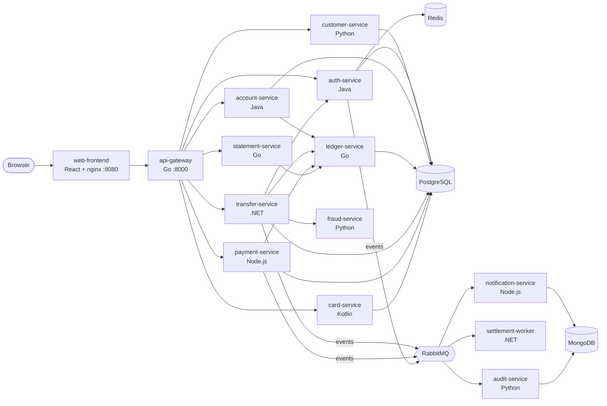
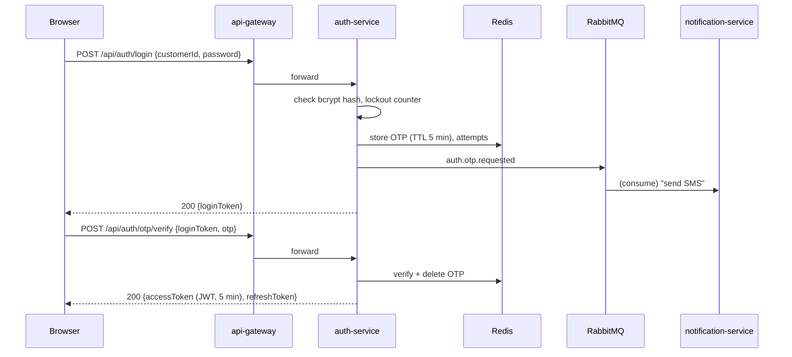

# VijayBank — Net Banking Platform: Design (Phase 0)

Status: **Approved** · Version 1.0 · 7 Nov 2026

VijayBank is a fictional retail bank. This project builds a net-banking
platform with features similar to a typical Indian retail bank (login with
OTP, accounts, statements, NEFT/IMPS/RTGS transfers, bill pay, cards, fixed
deposits), as a polyglot microservices system that runs locally with Docker
Compose. Observability is added in Phase 5.

All data is fake. VijayBank has its own name and look and does not copy any
real bank's branding.

---

## 1. Goals and non-goals

**Goals**
- Realistic banking flows, including the hard parts: correct money movement,
  idempotent transfers, OTP step-up, limits, fraud checks, audit trail.
- 10+ services in 7 languages, so instrumentation can be practised per language.
- One command to run everything locally: `docker compose up -d --build`.
- Built "observability-ready": structured logs, health endpoints, request IDs.
- Failure switches (Phase 4) that create realistic incidents to investigate.

**Non-goals**
- Real payment rails, real SMS/e-mail, real KYC — all simulated.
- Production-grade security hardening (we follow good practice, but this is a lab).
- Mobile app.

---

## 2. Feature scope

| Area | Features | Phase |
|---|---|---|
| Login & security | Customer ID + password, OTP (simulated SMS), JWT session, idle timeout (5 min), lock after 5 failed attempts, logout | 1 |
| Dashboard | Accounts, balances, last 5 transactions | 1 |
| Profile | Name, masked mobile/e-mail, address, KYC status | 1 |
| Accounts | Savings and current accounts, balance, account details | 1 |
| Statements | Filter by date range / type, paginated, download **PDF** and CSV | 2 |
| Fund transfer | Own accounts, VijayBank customers, other banks via NEFT / IMPS / RTGS (simulated), OTP step-up, daily limits | 2 |
| Beneficiaries | Add (OTP + 30-min cooling period), list, delete | 2 |
| Fraud checks | Rule-based score on every transfer | 2 |
| Notifications | SMS / e-mail simulation, notification history | 2 |
| Bill payments | Electricity, mobile, DTH, gas (simulated billers) | 3 |
| Cards | Debit / credit card list, block/unblock, set limits | 3 |
| Deposits & loans | Open fixed deposit, view FDs and loans | 3 |

**First usable version (end of Phase 2):** login + OTP, dashboard, statements (with PDF),
beneficiaries, fund transfer, notifications.

---

## 3. Architecture



### 3.1 Services

| Service | Language / framework | Port (internal) | Owns | Phase |
|---|---|---|---|---|
| web-frontend | React 18 + TypeScript (Vite), served by nginx | 8080 (published) | UI | 1 |
| api-gateway | Go 1.23 (net/http + chi) | 8000 (published) | Routing, JWT validation, rate limiting, request IDs | 1 |
| auth-service | Java 21, Spring Boot 3 | 8081 | Credentials, OTP, sessions, lockout | 1 |
| customer-service | Python 3.12, FastAPI | 8082 | Customer profile, KYC status | 1 |
| account-service | Java 21, Spring Boot 3 | 8083 | Account metadata (type, status, branch, IFSC) | 1 |
| ledger-service | Go 1.23 | 8084 | **Double-entry ledger and balances — single source of truth for money** | 1 |
| transfer-service | .NET 8 (ASP.NET Core) | 8085 | Beneficiaries, limits, transfer workflow | 2 |
| fraud-service | Python 3.12, FastAPI | 8086 | Risk scoring rules | 2 |
| notification-service | Node.js 20 (Express) | 8087 | SMS/e-mail simulation, history | 2 |
| settlement-worker | .NET 8 worker | — | Simulated NEFT batches / IMPS / RTGS clearing | 2 |
| audit-service | Python 3.12 (consumer) | 8088 | Immutable audit log of security and money events | 2 |
| statement-service | Go 1.23 | 8089 | Statements, PDF and CSV export | 2 |
| payment-service | Node.js 20 (Express) | 8090 | Billers, bill payments | 3 |
| card-service | Kotlin (Ktor) | 8091 | Cards, block/unblock, limits | 3 |
| loadgen | Python (Locust) | 8093 (UI) | Synthetic customer traffic, on/off | 4 |

**Languages covered:** Go, Java, Kotlin, Python, .NET (C#), Node.js, TypeScript.

### 3.2 Infrastructure

| Component | Version | Used for |
|---|---|---|
| PostgreSQL | 16 | One instance, **one database per service** (`auth`, `customer`, `account`, `ledger`, `transfer`, `payment`, `card`). Services never read another service's database. |
| Redis | 7 | OTPs (5-min TTL), session deny-list, rate limits, login-attempt counters |
| RabbitMQ | 3.13 (with management UI) | Domain events (topic exchange `vijaybank.events`), retries and dead-letter queues |
| MongoDB | 7 | Notification history, audit log (append-only) |

### 3.3 Published ports (host)

| Port | What |
|---|---|
| 8080 | Net banking UI |
| 8000 | API gateway (for curl / Postman) |
| 8093 | Load generator UI (Phase 4) |

Everything else is internal. Phase 5 adds Grafana (3000), Prometheus (9090),
Jaeger (16686) etc. — no clashes with the ports above.

---

## 4. Money correctness (the most important section)

1. **Amounts are integers in paise** (`BIGINT`, ₹1 = 100 paise). Never floats.
2. **Double-entry ledger.** Every money movement is a *journal* with ≥ 2
   *entries* whose debits and credits sum to zero. Balances are never edited
   directly.
3. **Atomic posting.** ledger-service writes the journal, entries and balance
   updates in **one database transaction**, locking the affected balance rows
   (`SELECT … FOR UPDATE`, always in account-number order to avoid deadlocks).
4. **No overdraft.** The posting fails if a savings balance would go below zero.
5. **Idempotency.** Every money-moving request carries an `Idempotency-Key`
   header (UUID, generated by the browser). transfer-service and
   ledger-service store the key with the result; a retry returns the original
   result instead of moving money twice.
6. **Internal bank accounts** (system-owned ledger accounts):
   `NEFT_CLEARING`, `IMPS_CLEARING`, `RTGS_CLEARING`, `BILLPAY_SETTLEMENT`,
   `FD_POOL`, `INTEREST_EXPENSE`.
7. **Reversals, not deletes.** A failed external transfer is undone with a
   new reversing journal; nothing is ever updated or deleted in the ledger.
8. **Reconciliation check** (Phase 4): sum of all entries = 0, and each
   balance = sum of its entries. Exposed as an endpoint and, later, a metric.

### 4.1 Ledger schema (ledger database)

```sql
ledger_accounts(account_no PK, owner_type CUSTOMER|INTERNAL, currency 'INR',
                balance_paise BIGINT, status, version, updated_at)
journals(id UUID PK, idempotency_key UNIQUE, type, reference, created_at)
entries(id BIGSERIAL PK, journal_id FK, account_no FK,
        direction DEBIT|CREDIT, amount_paise BIGINT CHECK (amount_paise > 0),
        balance_after_paise BIGINT, narration, created_at)
```

---

## 5. Key flows

### 5.1 Login with OTP



- Wrong password 5 times → account locked 30 min, `auth.account.locked` event.
- The simulated SMS is visible in the UI's "Developer inbox" panel (and in
  notification-service logs), so you can complete the flow locally.
- JWT signed with RS256; api-gateway validates it with auth-service's public key.

### 5.2 Fund transfer (IMPS to another bank)

```mermaid
sequenceDiagram
  participant B as Browser
  participant T as transfer-service
  participant A as auth-service
  participant F as fraud-service
  participant L as ledger-service
  participant K as RabbitMQ
  participant S as settlement-worker
  B->>T: POST /api/transfers (Idempotency-Key)
  T->>T: validate beneficiary (active, cooling period over), limits
  T->>A: request step-up OTP
  T-->>B: 202 {transferId, status: OTP_REQUIRED}
  B->>T: POST /api/transfers/{id}/confirm {otp}
  T->>A: verify OTP
  T->>F: POST /score
  alt score >= 80
    T->>K: transfer.blocked
    T-->>B: 422 blocked by fraud check
  else
    T->>L: POST /journals (debit customer, credit IMPS_CLEARING)
    T->>K: transfer.debited
    K->>S: consume
    S->>S: simulate network (IMPS: ~1 s; NEFT: next 30 s batch)
    alt success
      S->>K: transfer.settled
    else failure
      S->>L: reversal journal
      S->>K: transfer.failed
    end
  end
```

- **Own-account and intra-bank transfers** post directly between two customer
  accounts and complete synchronously.
- **Statuses:** `OTP_REQUIRED → PROCESSING → COMPLETED | FAILED | BLOCKED`.
- The UI polls `GET /api/transfers/{id}` until a final status.

### 5.3 Transfer rules (simulated, illustrative values)

| Mode | Per transaction | Settlement (simulated) |
|---|---|---|
| Own / intra-bank | up to ₹10,00,000 | Instant |
| IMPS | up to ₹5,00,000 | ~1 second |
| NEFT | up to ₹10,00,000 | Batched every 30 seconds |
| RTGS | minimum ₹2,00,000 | ~2 seconds |

- Daily limit per customer: ₹10,00,000 across all modes.
- New beneficiary: max ₹50,000 in the first 24 hours.

### 5.4 Fraud rules (fraud-service, score 0–100)

| Rule | Points |
|---|---|
| Amount > ₹2,00,000 | 30 |
| Beneficiary added < 24 h ago | 25 |
| > 5 transfers in 10 minutes | 30 |
| First transfer to this bank | 10 |
| Odd hours (00:00–05:00) | 10 |

≥ 80 → block; 50–79 → allow and flag (`fraud.flagged` event).

---

## 6. API overview (through api-gateway)

All under `/api`, JSON, JWT in `Authorization: Bearer …` except login.
Full contracts will be written as OpenAPI files in `contracts/` in Phase 1.

| Method | Path | Service |
|---|---|---|
| POST | `/auth/login`, `/auth/otp/verify`, `/auth/refresh`, `/auth/logout` | auth |
| GET | `/customers/me` | customer |
| GET | `/accounts`, `/accounts/{no}` | account (+ ledger balance) |
| GET | `/accounts/{no}/transactions?from&to&type&page` | statement |
| GET | `/accounts/{no}/statement.csv` / `.pdf` | statement |
| GET/POST/DELETE | `/beneficiaries` | transfer |
| POST | `/transfers`, `/transfers/{id}/confirm` | transfer |
| GET | `/transfers/{id}`, `/transfers?page` | transfer |
| GET | `/notifications` | notification |
| GET/POST | `/billers`, `/bill-payments` | payment |
| GET/POST | `/cards`, `/cards/{id}/block`, `/cards/{id}/limits` | card |
| GET/POST | `/deposits` | account |

Errors use one format everywhere:
`{ "error": { "code": "INSUFFICIENT_FUNDS", "message": "…", "requestId": "…" } }`

---

## 7. Events (RabbitMQ)

All events are published to one **topic exchange**, `vijaybank.events`, with
the event type as routing key. Each consumer owns its queue and binds the
patterns it needs.

| Routing keys | Producer | Example events |
|---|---|---|
| `auth.*` | auth | `auth.otp.requested`, `auth.login.succeeded`, `auth.login.failed`, `auth.account.locked` |
| `transfer.*` | transfer, settlement | `transfer.debited`, `transfer.settled`, `transfer.failed`, `transfer.blocked` |
| `billpay.*` | payment | `billpay.completed`, `billpay.failed` |
| `fraud.*` | fraud | `fraud.flagged` |
| `card.*` | card | `card.blocked`, `card.limit.changed` |

| Queue | Consumer | Bindings |
|---|---|---|
| `notification.events` | notification-service | `auth.otp.requested`, `auth.account.locked`, `transfer.*`, `billpay.*`, `card.*` |
| `settlement.transfers` | settlement-worker | `transfer.debited` |
| `audit.all` | audit-service | `#` (everything) |

- Envelope: `{ eventId, type, occurredAt, customerId, requestId, data }`.
- Messages are **persistent**, queues are **durable**, consumers use manual
  acknowledgements.
- Each queue has a **dead-letter queue** (`<queue>.dlq`): a message that fails
  3 times is parked there instead of blocking the queue.
- Consumers are **idempotent** (they record processed `eventId`s), because
  RabbitMQ can deliver a message more than once.
- Publishers use **publisher confirms**, so an event is not lost if the broker
  restarts mid-publish.

---

## 8. Cross-cutting conventions (from day one)

| Concern | Convention |
|---|---|
| Logging | JSON to stdout: `timestamp, level, service, requestId, customerId (when known), message`. **Never** log passwords, OTPs, full account or card numbers. |
| Request ID | Gateway creates `X-Request-Id` if missing; every service forwards it on HTTP calls and in RabbitMQ message headers. Phase 5 replaces/augments this with W3C `traceparent`. |
| Health | `GET /health/live` and `GET /health/ready` on every service; used by Compose healthchecks. |
| Config | Environment variables only; defaults in `docker-compose.yml`, secrets in `.env` (git-ignored, `.env.example` committed). |
| Masking | Account numbers shown as `XXXXXX1234`, mobile as `XXXXXX7890`. |
| Time | UTC in storage and logs; IST in the UI. |
| Containers | Multi-stage Dockerfiles, non-root user, pinned base image versions. |

---

## 9. Repository layout

```
vijaybank/
├── docker-compose.yml
├── .env.example
├── README.md
├── docs/
│   └── DESIGN.md            ← this file
├── contracts/               ← OpenAPI + event schemas
├── infra/
│   ├── postgres/init/       ← creates one database + user per service
│   └── rabbitmq/            ← exchange, queues, DLQs (definitions.json)
├── services/
│   ├── web-frontend/        (React/TS)
│   ├── api-gateway/         (Go)
│   ├── auth-service/        (Java)
│   ├── customer-service/    (Python)
│   ├── account-service/     (Java)
│   ├── ledger-service/      (Go)
│   ├── transfer-service/    (.NET)
│   ├── fraud-service/       (Python)
│   ├── notification-service/(Node.js)
│   ├── settlement-worker/   (.NET)
│   ├── audit-service/       (Python)
│   ├── statement-service/   (Go)
│   ├── payment-service/     (Node.js)
│   └── card-service/        (Kotlin)
├── loadgen/                 ← Phase 4
└── observability/           ← Phase 5
```

---

## 10. Seed data

- 20 fictional customers (IDs `VB100001`…`VB100020`), password `Welcome@123`
  for all (lab only).
- Each with a savings account (some also current), opening balances between
  ₹10,000 and ₹25,00,000 posted as proper opening journals.
- Pre-added beneficiaries, a few at "other banks" with fake IFSC codes
  (`OTHB0000001` etc.).
- 6 months of historical transactions so statements look real.

---

## 11. Failure switches (Phase 4 preview)

Toggled at runtime through an internal `/admin/faults` endpoint, so incidents
can be created on demand for observability practice:

| Switch | Effect |
|---|---|
| `ledger.slow_db` | Adds 1–3 s to ledger postings (lock contention) |
| `fraud.down` | fraud-service returns 503 → transfers fail or fall back |
| `otp.delay` | OTP SMS arrives after 60 s → login drop-off |
| `settlement.neft_failure` | 30% of NEFT batches fail → reversals |
| `mq.consumer_slow` | notification-service consumes slowly → queue backlog, late OTPs |
| `auth.memory_leak` | Gradual heap growth in auth-service |
| `statement.slow_query` | Missing-index style slow statement queries |
| `gateway.rate_limit_storm` | Very low rate limit → many 429s |

---

## 12. Observability plan (Phase 5 preview)

- OpenTelemetry in every service (auto-instrumentation agent for Java/.NET/
  Node/Python, SDK for Go).
- One trace from button click → gateway → transfer → fraud → ledger →
  RabbitMQ → settlement → notification.
- Collector → Prometheus, Jaeger/Tempo, Loki; Grafana dashboards:
  - **Business:** logins/min, OTP success %, transfers by mode and status,
    money moved per hour, fraud blocks, settlement delay.
  - **Service RED** and **infrastructure** (Postgres, Redis, RabbitMQ queue depth, Mongo).
- PII redaction in the Collector (account numbers, mobile numbers).
- Alerts: transfer failure rate, OTP delivery latency, ledger reconciliation
  mismatch, RabbitMQ queue backlog / dead-letter messages.
- Then the same telemetry to New Relic and Elastic for comparison.

---

## 13. Phase plan and exit criteria

| Phase | Deliverable | Done when |
|---|---|---|
| 0 | This design | Reviewed and agreed |
| 1 | gateway, auth, customer, account, ledger, frontend; Postgres + Redis + RabbitMQ in Compose; seed data | Log in with OTP and see accounts and balances in the browser |
| 2 | transfer, fraud, notification, settlement, audit, statement | Transfer money (own / intra / IMPS / NEFT), view and download PDF statements, reversals work |
| 3 | payment, card, deposits | All features in section 2 work |
| 4 | loadgen, failure switches, reconciliation | Traffic runs on/off; each switch causes a visible problem |
| 5 | Full observability stack | Every switch can be diagnosed from dashboards, traces and logs |
| 6 | Vendors, Word guide, GitHub | Pushed and documented |

---

## 14. Decisions (review of 7 Nov 2026)

| Question | Decision |
|---|---|
| Message broker | **RabbitMQ** |
| Language per service (3.1) | Approved as listed |
| Transfer rules and limits (5.3) | Approved as listed |
| Statement format in first version | **PDF** (CSV also offered) — delivered in Phase 2 |
